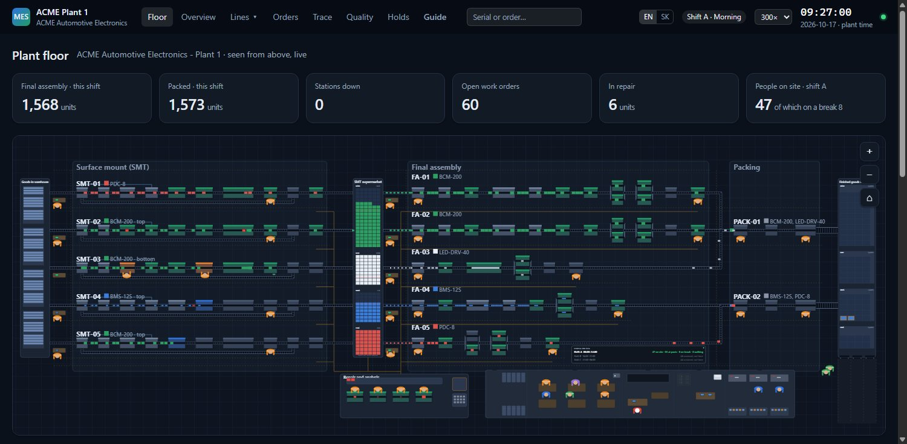

# MES lab

A virtual automotive electronics plant and the manufacturing execution system
(MES) that runs it. The plant is a discrete-event simulation; the MES is a
FastAPI + PostgreSQL web application. Everything is fictional:
**ACME Automotive Electronics, Plant 1** builds body control modules, LED drivers,
battery management boards and park distance control units for invented customers.



## What runs where

```
 +---------------------------- plant (SimPy) ----------------------------+
 |  SMT-01..05      supermarket     FA-01..05      PACK-01..02  warehouse |
 |  10 stations ->  (PCB assys)  -> 6-13 stations -> KLT/pallet ->        |
 |        \__ wash (SPI) __/          \__ repair center RPR-01 __/        |
 |                                                                        |
 |  edge gateway: condenses machine signals (state time per hour, counts, |
 |  defects, downtime events, job progress, live snapshot) and publishes  |
 |  where every piece is right now (floor snapshot, memory only)          |
 +------------------------------+-----------------------------------------+
                                |  REST, once per wall-clock second
                                v
 +------------------------------+-----------------------------------------+
 |  MES (FastAPI)               |                                         |
 |  /api/v1/edge/ingest         upserts into PostgreSQL                   |
 |  /api/v1/dispatch/next-job   lines ask for work -> demo planner        |
 |  /api/v1/sim/runs            a new run = empty shop floor              |
 |  web: plant floor (live, from above), overview, line view, work orders |
 +------------------------------------------------------------------------+
```

* **Plant model** (`config/*.yaml`): areas, lines, stations, station types with
  their behaviour (MTBF/MTTR, minor stops, changeovers, defects and detection
  probabilities, false calls), materials and routings with ideal cycle times,
  shifts, defect codes and downtime reasons. The equipment and material model
  follows ISA-95.
* **Simulation** (`src/mes_lab/sim`): every station is a SimPy process with the
  states RUNNING, STARVED, BLOCKED, DOWN, MINOR_STOP, CHANGEOVER, MAINTENANCE and
  NO_ORDER. Double-sided boards run bottom side first, then top side. Misprinted
  panels are washed and printed again, boards found bad by AOI get a bad mark and
  are repaired after depaneling, units failing in final assembly go to the repair
  center and come back to the station that rejected them, carried by robots (below). Conveyor ovens hold
  several items at a time. Time runs 1x to 600x faster than the wall clock, with a
  fixed random seed.
* **MES** (`src/mes_lab/mes`): master data synced from the YAML, work orders and
  jobs (one job = one routing operation on one line), dispatching, the condensed
  production history, and the web pages. Until the fake ERP exists, a demo planner
  creates final assembly orders and keeps the SMT supermarket above its safety
  stock (`src/mes_lab/planning.py`).
* **Traceability** (`src/mes_lab/mes/trace.py`): interlocked stations check every
  piece in before working on it. The MES refuses scrapped pieces, pieces on hold,
  pieces with open defects and pieces that skipped a routing step, and it issues
  the serial numbers (panel and boards at the PCB laser, the product at the final
  assembly loader, KLT boxes and SSCC pallet numbers at packing). Every operation is
  checked out with its result, defects and measurements. Genealogy links
  panel -> board -> unit -> KLT -> pallet; repairs return a unit to the station that
  found its defect; holds (serial, work order, or station + time window, plus
  everything made from it) stop pieces at their next check-in and park them in
  quarantine until they are released or scrapped.
* **Plant floor** (`/`, `src/mes_lab/layout.py`, `sim/floor.py`, `web/static/floor-*.js`):
  the plant seen from above, live. The floor plan is computed from the plant model
  and serves two readers: the page draws machines, belts and warehouses from it, and
  the simulation takes the length of every belt from it, so a piece that rides from an
  SMT line to the supermarket needs as long as the picture shows (goods-in -> SMT,
  SMT -> supermarket -> final assembly -> packing -> warehouse, washing, the return belt of
  the second board side underneath the machines). Where a walkway or a robot lane crosses a
  belt, the belt goes over it on a bridge (tested: no path crosses a belt anywhere else). The simulation
  publishes once a second where every piece is (in a machine, in the queue in front of
  it, on a belt), which phase every machine is in and how far its cycle has got. The
  page follows each piece by its id and draws only that: a tool moves while a piece is
  really inside, and what a piece looks like comes from the stations it has passed and
  from its product. The same view is on every line page, and as a close-up in the
  pop-up of a station. Pieces, KLT boxes and pallets are drawn in their real
  proportions (`config/products.yaml`), a piece shows its serial number and a box or
  pallet lists what is inside (the serial browser reads the trace API).
* **People and shipping** (`config/crew.yaml`, `sim/crew.py`, `sim/shipping.py`,
  `layout_crew.py`, `web/static/floor-people.js`): operators sit in seats (machine or team
  desk of a line), maintenance and IT technicians come for breakdowns (`config/codes.yaml`
  says which reasons are for IT), the foreman walks his rounds, logistics workers load the
  trucks. Everyone walks along the aisles and through the doors of the plan at walking speed (around the furniture with room for the shoulders, never through walls; the snapshot carries the last walks, so the page draws the real way between two snapshots) and has a desk of their own, chair pushed in, monitor, keyboard and mouse, where they face the screen; IT takes a laptop to a call, maintenance fetches measuring instruments when the fault asks for them; three shifts, a
  hand-over at the seat (the next person waits beside it, the old one walks out through a turnstile), a half hour lunch and ten minutes of coffee each, covered by a relief person who waits at a place of their own (and now and then a trip to the toilet: the men's or the women's, into a cabin whose door shuts, then the hands are washed); everybody going in passes an ESD gate (one at a time, the queue moves up) and the technicians put on an ESD coat, hand over to their successor around the end of the shift and leave the coat in the locker; logistics workers idle for five minutes sit down at the table in their corner (cards with a colleague, a book alone); a sign shows the head count per shift. People are men and women (`crew.women`, female surnames in their Slovak form) and look the same on the plan and on the badge photo of their panel.
  Finished pallets wait in the warehouse until the truck of their customer comes (timetable
  per customer); it takes the oldest ones and the delivery note (ASN) reaches the MES,
  which marks pallets, boxes and units `SHIPPED`.
* **Traffic** (`sim/traffic.py`, `layout_crew.py`): nobody walks through anybody. Every aisle has a
  walkway with two lanes (people keep to the right) and beyond it a robot lane; people stand beside
  the walkways (operator, technician and the next person each have their own place at a machine).
  Every walk and every drive is checked against everybody else's plan before it starts (people are
  circles, robots 32 x 21 rectangles along their way); the later one waits where they are until the
  crossing, the door or the turnstile is free. `scripts/overlaps.py` counts what still touches.
* **Robots (AMR)** (`sim/amr.py`, `sim/supply.py`, `config/crew.yaml` `amr:`, `web/static/floor-robots.js`): nothing
  flies across the plant. A rejected piece goes into the red NOK tote at the exit of its cell; a fleet
  manager sends the nearest free autonomous mobile robot, which drives along its lane in the
  aisle, slides sideways into the gap beside the tote and brings it to the pass-through rack in the wall of the repair
  centre. The robots also run the line-side material as a two-bin kanban: bins with the parts of a unit
  (`kit` in `products.yaml`) to the rack at the loader of every final assembly line and the empty bins
  back, stacks of empty KLT boxes to packing; with no full bin left the loader stops. Battery: drains
  while driving (more with a load) and a little while standing, charges on the charger. The repair person of a free bench fetches the piece from the rack, repairs it and carries
  it to the outbound rack (or the scrap bin); a robot takes it back to the cell the MES names
  (boards to the supermarket). Pieces the MES refuses go to the quarantine cage and back the same
  way. Robots have a battery, chargers in a depot and one dock per stop; the page draws every
  piece in the tote, on the robot, in the rack or in the hands of the repair person.
* **Calls from the MES** (`POST /api/v1/crew/calls`, "Call a person" on the Floor page): like the
  andon button of a station, a signed-in user calls somebody of maintenance, IT, the foreman or
  logistics to a machine; the call reaches the plant with the answer to its next report, the
  nearest free person walks there, stays and walks back, and the page follows the call.
* **Pause and a jump in time** (`mes/floor.py` `SimControl`, `sim/runner.py` `live_step`): a signed-in
  user stops the whole plant (it ends by itself after half an hour) or sends it ahead to a later plant
  time as fast as the MES keeps up, then paused or running on.
* **KPI** (`/kpi`, `src/mes_lab/kpi.py`, `mes/kpi_views.py`): OEE (availability x performance x quality
  at the constraint of each line), FPY and RTY, automation degree, productivity per person-hour,
  MTBF/MTTR, scrap and repairs, robot utilization, the capacity of the areas in lines, and the cost of
  a good unit with the margin (`config/costs.yaml`), over this shift, 8 h, 24 h or 7 days.
* **Tuning game** (`/tuning`, `src/mes_lab/tuning.py`, `mes/tuning_views.py`): change the plant (SMT
  lines, robots, technicians, relief people, bins of parts, buffers), run it offline in a worker
  process with a fixed seed and compare its margin per hour with the plant as it is; the best
  scenarios stay on a board. A signed-in user can put a scenario into the live plant
  (`mes/scenario.py`, `POST /api/v1/plant/scenario`): the plant learns it with the answer to its next
  report, starts a new run built with those knobs and tells the MES which lines it has; the work of the
  missing lines moves to the others, the planner and the pages follow, and every page says so.
* **Live view at any speed** (`web/static/floor-core.js`): the picture runs a second behind the plant on
  purpose, so every walk, drive and ride (`trh`, `at` in the snapshot) is known in full before it is
  drawn: at 60x people still go along the walkways, not straight through the walls.
* **Explanations**: a guide page (`/guide`) and a help box on every page, in English
  and Slovak, explain the plant and the screens for people who never saw a factory.

## Running it locally (Windows)

```
python -m venv .venv
.venv\Scripts\pip install -e ".[dev]"
.venv\Scripts\python -m mes_lab.dev --speed 60
```

Then open http://127.0.0.1:8070. `start-local.cmd` does the last step.
Without `MES_DATABASE_URL`, development uses a private PostgreSQL from the
`pgserver` package with its data in `var/pgdata` (created on first start).
The simulation speed can be changed in the page header.

Other entry points:

| Command | What it does |
|---|---|
| `python -m mes_lab.sim offline --hours 168` | one plant week without the MES, as fast as possible, prints a report |
| `python -m mes_lab.mes` | only the MES |
| `python -m mes_lab.mes user NAME` | create a web user (prints a generated password) |
| `python -m mes_lab.sim run --speed 60` | only the plant, against a running MES |
| `python -m pytest` | tests (model, floor plan, simulation, live snapshot, MES API, simulation driving the MES; the browser code runs in Node when it is installed) |

Environment: `MES_DATABASE_URL` (postgresql+psycopg://...), `MES_EDGE_TOKEN`
(required bearer token on the shop-floor API when set), `MES_REQUIRE_LOGIN=1`,
`MES_SECRET_KEY`, `MES_COOKIE_SECURE=1`, `MES_RETENTION_DAYS` (unit-level history
kept for that many plant days), `MES_URL` for the plant.

The schema is managed with Alembic; the MES migrates on start. After changing
`models.py` run `python scripts/new_migration.py "what changed"` and review the file.

## Deployment

`scripts/deploy.sh` ships the committed HEAD to an Ubuntu 24.04 VM: PostgreSQL,
Caddy (HTTPS), two systemd services (`mes-lab-mes`, `mes-lab-sim`) and a host
firewall opening 80/443 (`deploy/`). Secrets are generated on the server in
`/etc/mes-lab/mes.env`. Users: `python -m mes_lab.mes user NAME`.

## Layout

```
config/            plant model (YAML)
src/mes_lab/model  loading and validating the plant model
src/mes_lab/layout.py     floor plan: machine and belt coordinates, shared by page and simulation
src/mes_lab/sim    simulation: stations, lines, plant, edge gateway, dispatchers
src/mes_lab/mes    MES: schema, ingest, dispatching, read models, web
src/mes_lab/planning.py   planning rules shared by the MES and offline runs
tests/
```

## Author

Designed and built by Michal Lukáč ([github.com/lukacmichal](https://github.com/lukacmichal)).
The plant, its products and its customers are fictional.

## Roadmap

1. Plant model, simulation core, database schema, minimal web - **done**
2. Check-in/check-out at stations, route enforcement, serial numbers and
   genealogy, search, quality and repair, holds; first deployment - **done**
3. Settings web (products, BOMs, routings, stations, reasons, shifts, users) with change log
4. Material (reels, MSL, feeder setup, solder paste), packing labels, shipping (ASN), fake ERP
5. OPC UA, MQTT / unified namespace, KPIs (OEE, FPY, MTBF/MTTR) - KPIs **done** (0.6.0)
6. Training scenarios and a read-only AI assistant
